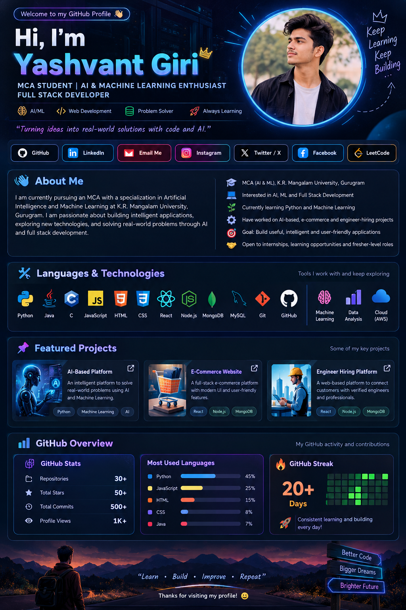

<!-- ═══════════ NEON AI/ML PROFILE ═══════════ -->

  

<h1 align="center">👋 Hi, I'm Yashvant Giri</h1>

<h3 align="center">
  MCA STUDENT | AI & MACHINE LEARNING ENTHUSIAST
   
  FULL STACK DEVELOPER
</h3>

  

  
  
  
  

  <i>“Turning ideas into real-world solutions with code and AI.”</i>

  
  
  
  
  

---

## 👋 About Me

<table>
  <tr>
    <td width="55%">

I'm currently pursuing an MCA specializing in **Artificial Intelligence and Machine Learning** at K.R. Mangalam University, Gurugram.

I'm passionate about developing intelligent applications, exploring new technologies, and solving real-world problems using AI and software development.

    </td>
    <td width="45%">

- 🎓 MCA — AI & ML
- 💻 Full Stack Development
- 🐍 Learning Python & ML
- 🤖 Interested in AI and Deep Learning
- 🚀 Building practical projects
- 🤝 Open to internships and fresher roles

    </td>
  </tr>
</table>

---

## ⚡ Languages & Technologies

  

  
  
  

---

## 🚀 Featured Projects

<table>
  <tr>
    <td width="33%" align="center">
      <h3>🤖 AI-Based Platform</h3>
      
Exploring AI-powered solutions to real-world problems.

      <strong>Python · AI/ML</strong>
    </td>
    <td width="33%" align="center">
      <h3>🛒 E-Commerce Website</h3>
      
A shopping website focused on usability and user experience.

      <strong>Web Development</strong>
    </td>
    <td width="33%" align="center">
      <h3>🏗️ Engineer Hiring Platform</h3>
      
A platform concept to connect customers with engineers.

      <strong>React · Node.js</strong>
    </td>
  </tr>
</table>

---

## 📊 GitHub Overview

  
  

  

---

## 🌐 Connect With Me

  <a href="https://x.com/vishal677665544">X / Twitter</a> •
  <a href="https://www.linkedin.com/in/yashvant-giri-686973383/">LinkedIn</a> •
  <a href="https://www.facebook.com/profile.php?id=100053566644363">Facebook</a> •
  <a href="https://www.instagram.com/goswami_vis/">Instagram</a> •
  <a href="https://leetcode.com/u/yasha2005/">LeetCode</a>

  

  <b>✨ Learn&nbsp; • &nbsp;Build&nbsp; • &nbsp;Improve&nbsp; • &nbsp;Repeat 🚀</b>

  Thanks for visiting my profile! 💙

